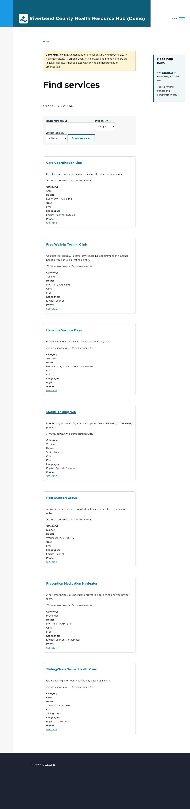
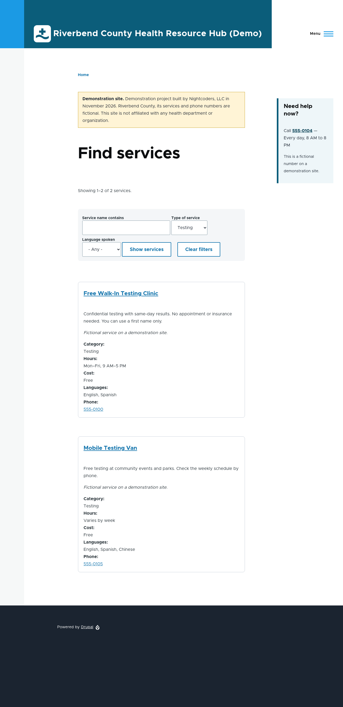
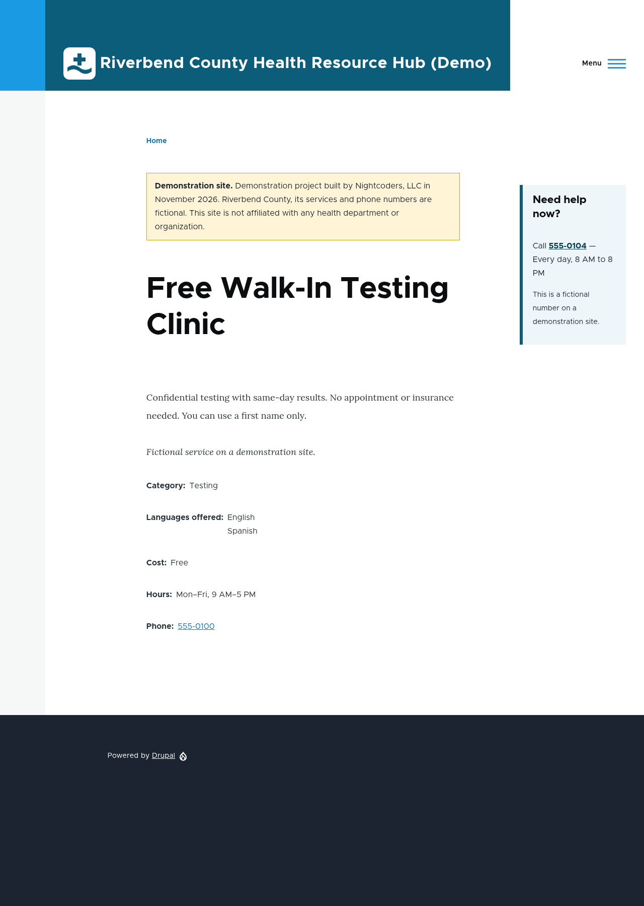
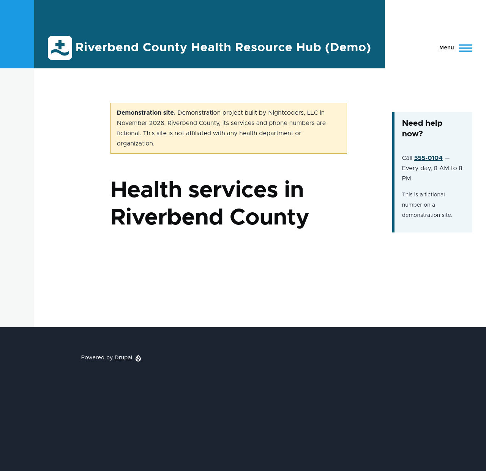

# Riverbend County Health Resource Hub — Drupal 11 demo

**Nightcoders demonstration project, built November 2026.** This is not client work. Riverbend County, its services and phone numbers are fictional. The site is not affiliated with any health department or organization and uses no third-party branding.

It shows how Nightcoders, LLC structures a small, accessible public-health resource directory in Drupal, with everything kept in code.

## What it shows

| Feature | Where |
|---|---|
| Drupal 11.4 (Composer `drupal/recommended-project`) on SQLite | `composer.json`, `composer.lock` |
| **Resource** content type: plain-language description, Category (taxonomy), Languages offered (multi-value list), Cost, Hours, Phone (telephone link) | `config/sync/node.type.resource.yml`, `field.*` |
| **Resources View** at `/resources` with exposed filters (name keyword, type of service, language), result count, empty-state text and a reset button | `config/sync/views.view.resources.yml` |
| **Riverbend** Olivero sub-theme: solid-color header and footer so contrast can be checked, stronger focus outline, card layout for results, and a "demonstration site" notice inside `<main>` | `web/themes/custom/riverbend/` |
| **Custom module** `health_hub_help`: a configurable "Need help now?" block (PHP attribute plugin, validated phone field, config schema, Twig template with a labelled region), placed in the sidebar `<aside>` | `web/modules/custom/health_hub_help/` |
| All site configuration exported to code; a fresh install imports it with `--existing-config` | `config/sync/` (172 files) |
| Fictional sample content created by a script, not stored in config | `scripts/sample-content.php` |
| The SQLite database, hash salt and private files live outside the web root and are git-ignored | `web/sites/default/settings.php`, `.gitignore` |

`scripts/build-structure.php` is the one-time script that first created the content type, fields, View and block placement before the config export. It is kept for transparency; a fresh install does not need it.

## Setup (local)

Requirements: PHP 8.3+ with pdo_sqlite, gd, xml, mbstring, curl and zip; Composer 2; SQLite 3.45+.

```bash
git clone <this repo> drupal-health-hub && cd drupal-health-hub
./scripts/setup.sh            # composer install, site:install --existing-config, sample content
cd web && php -S 127.0.0.1:8888 .ht.router.php
# open http://127.0.0.1:8888 and http://127.0.0.1:8888/resources
```

`setup.sh` prints a random local admin password (user `demo-admin`). Set `ADMIN_PASS=...` to choose one.

Config workflow: `vendor/bin/drush cex` to export after changes, and `vendor/bin/drush cim` to import. Verified on Nov 24, 2026: a fresh clone runs `setup.sh` without errors, all pages return 200, and `drush config:status` reports no differences between the database and `config/sync`.

Security: `composer audit` reported no advisories after updating `twig/twig` to 3.31.1 on Nov 24, 2026.

## Accessibility results (WCAG 2.1 AA)

Tested Nov 24, 2026 against the local site, with Google Chrome 156:

| Page | axe-core 4.14.1 (WCAG 2.0/2.1 A+AA and best-practice tags) | pa11y 10.0.0 (WCAG2AA; axe + HTML_CodeSniffer runners) |
|---|---|---|
| `/` (home) | 0 violations, 40 passed rules, 0 needing review | No issues found |
| `/resources` | 0 violations, 47 passed rules, 0 needing review | No issues found |
| `/resources?category=1` (filtered) | 0 violations, 47 passed rules, 0 needing review | No issues found |
| `/node/1` (a Resource) | 0 violations, 42 passed rules, 0 needing review | No issues found |
| `/about-testing` | 0 violations, 42 passed rules, 0 needing review | No issues found |

Keyboard check (`scripts/a11y/keyboard-check.js`): the first Tab press focuses a visible "Skip to main content" link, and Enter moves focus to the main content.

What the first scans caught and how it was fixed:
- pa11y flagged color contrast on the site name, the footer and the filter selects. Olivero's gradient and background-image styling stopped the contrast from being computed. The sub-theme switched these to solid colors with checked contrast.
- The demo notice was being squeezed into one grid column. It was set to span the full width.

Raw axe JSON is in `a11y/`.

Automated tools find only part of the WCAG issues. A full audit would also include manual screen reader testing (NVDA/JAWS/VoiceOver), zoom and reflow to 400%, and content review.

## Screenshots

| Find services (View with exposed filters) | Filtered: Testing |
|---|---|
|  |  |

| Resource page | Home |
|---|---|
|  |  |

## Hosting note

This repository is for local review. It is not deployed to any Nightcoders or client server.

## License

Custom code (the `health_hub_help` module, the `riverbend` theme and the scripts) is GPL-2.0-or-later, matching Drupal. Drupal core is GPL-2.0-or-later (see `LICENSE.txt`). Content is fictional sample text and is not medical advice.
